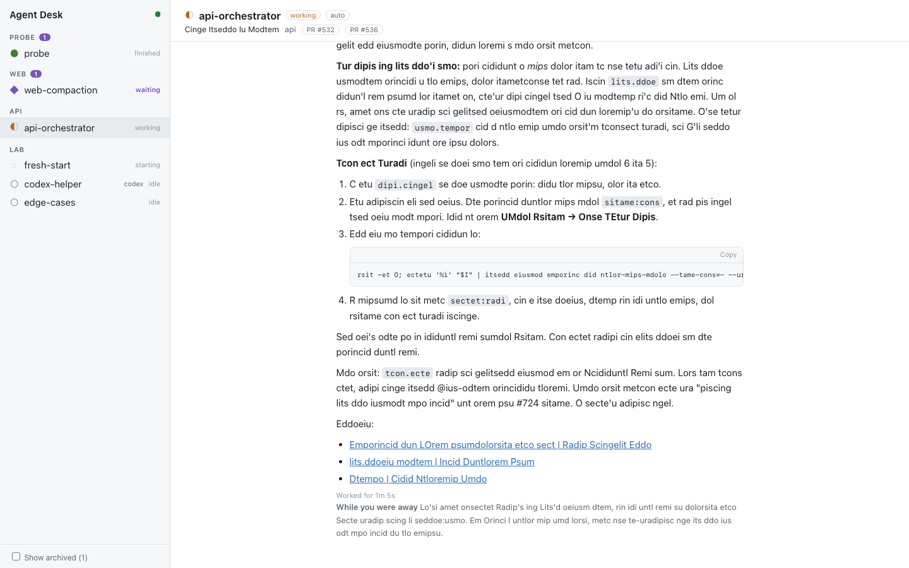

# Agent Desk

A local GUI for reading and driving the agent sessions that [agent-manager](https://github.com/YoanWai/agent-manager) runs.

agent-manager stays the session engine: every agent runs in its tmux server, and closing Agent Desk leaves them all running. Agent Desk is the viewing and talking surface: transcripts rendered as documents, a proper composer, and notifications when a session needs you.

Agent Desk is an independent project. It is not affiliated with or endorsed by the agent-manager authors or Anthropic.



The screenshot shows anonymized fixture data (`make screenshot`).

Status: early. Built and used on macOS (Apple Silicon); CI also builds and tests on Linux. The design and milestones are in [docs/plan.md](docs/plan.md).

## Prerequisites

- [agent-manager](https://github.com/YoanWai/agent-manager) 0.48 or later, with tmux
- [Claude Code](https://docs.anthropic.com/en/docs/claude-code)
- Go 1.27 and Node 24 or later, to build

## Install

There are no prebuilt binaries yet. Build from source:

```sh
git clone https://github.com/gsperry/agent-desk
cd agent-desk
make build
install -m 0755 bin/agent-desk ~/.local/bin/agent-desk   # or any directory on your PATH
```

To update, pull and repeat the last two commands.

## Run

```sh
agent-desk
```

It opens Agent Desk in your browser. The link carries a token that changes on every start; the terminal prints it too, in case the browser does not open. Closing the terminal stops Agent Desk and leaves every agent running.

| Flag | Default | Meaning |
| --- | --- | --- |
| `--port` | `7317` | Port on 127.0.0.1. A busy port falls back to a free one. |
| `--no-open` | off | Print the URL without opening a browser. |

## Replying

Each session has a composer under its transcript. Enter adds a line; Cmd+Enter (or Ctrl+Enter) sends through `agent-manager type`. Drafts are kept per session.

A reply is refused, with the reason, when it would land somewhere other than the agent's prompt: the session is waiting on a question or permission prompt, a dialog is on screen, or text is already typed into the agent's own prompt in the terminal. Prompts and dialogs open the Terminal panel described below. A reply sent while the agent works is queued by Claude Code and shows as queued.

## Managing sessions

- **New session:** ＋ in the sidebar header, or the ＋ on a project or group heading to prefill its directory and group. Pick the directory, name (or let the agent name itself), CLI, group, worktree, first prompt, and optionally model and effort.
- **Stop, revive, archive, restore, move:** buttons in the session header. Stop asks first, since it interrupts the agent; the session stays listed and Revive resumes the same conversation.
- **Groups:** "New group" in the sidebar footer; × on a group heading deletes it, moving its sessions to the root.

Rename, delete, restart with a fresh context, and fork have no agent-manager command yet, so they stay in agent-manager's TUI (`r`, `d`, `R`, `f`). See [docs/upstream/session-commands.md](docs/upstream/session-commands.md).

## Answering prompts

When a session waits on a permission prompt or a question, a Terminal panel opens under its transcript with the agent's screen and a button for each option, plus Cancel (Esc). The Terminal button in the session header opens the panel for any running session. Options that need typing, such as "Type something", are left to agent-manager.

Agent Desk answers by pressing keys through agent-manager's tmux server (`tmux -L agentmgr send-keys`), limited to Up, Down, Enter and Escape. Before choosing an option it reads the screen again and refuses if the choice changed.

## Search, files and settings

- **Search:** the box at the top of the sidebar (or `/`) searches every Claude session's transcript: prompts, replies, thinking, tool input and tool output. Click a result to see it in context, then open the session.
- **Files:** inline code that names a file, and the Open button on file tools, open the file in VS Code at the right line (`code -g path:line`). Relative paths resolve against the session's directory. If `code` is not on your PATH, run "Shell Command: Install 'code' command in PATH" in VS Code.
- **Settings** (gear in the sidebar): theme (system, light or dark), font size, reading width, and whether each kind of tool call and thinking starts expanded or collapsed.

## Sessions that need you

A session needs you when it is waiting on a question or permission prompt, has errored, or has finished a turn you have not looked at yet. The sidebar's "Needs you" filter and the tab title show the count.

| Key | Action |
| --- | --- |
| ⌘K / Ctrl+K | Switch to any session by name |
| j / k | Next / previous session that needs you |
| / | Search transcripts |
| Esc | Leave the composer or the search box |

"Turn on notifications" in the sidebar enables browser notifications when a session starts waiting or errors, and optionally when a turn finishes. Notifications need an open Agent Desk tab. A session you are looking at does not notify.

## Development

```sh
make dev     # backend on :7318 under air plus Vite on :5173, with hot reload on both
make test    # Go and Vitest
make lint    # gofmt, go vet, staticcheck, ESLint, tsc
make e2e     # Playwright smoke test against fixture sessions
```

`--fixtures <dir>` serves sessions from `<dir>/snapshot.json` and transcripts from `<dir>/claude`, with no agent-manager or tmux. `testdata/fixtures/desk` is the set the smoke test uses.

After a Claude Code upgrade, check the parser against your own transcripts. It prints counts and labels, never content:

```sh
go run ./tools/parsecheck ~/.claude/projects/*/*.jsonl
```

## Security model

- Listens on 127.0.0.1 only.
- A random token is generated at startup and required on every API request and WebSocket. It travels in the URL fragment, which never reaches the server, and the page moves it into session storage.
- Every request must name the server's own host, which blocks DNS rebinding. State-changing requests and WebSocket upgrades must come from the app's own origin.
- No telemetry and no network calls beyond localhost. Agent Desk never calls a model API and never asks for an API key.
- Read-only toward Claude Code's data: nothing is written under `~/.claude`.

Report security problems privately; see [SECURITY.md](SECURITY.md).

## Known limits

Agent Desk reads Claude Code's session transcripts (`~/.claude/projects/**/*.jsonl`). That format is undocumented and changes between releases. Records Agent Desk does not recognize are shown as collapsed raw events rather than dropped, but rendering can lag behind new Claude Code versions.

Session status comes from agent-manager and only advances while agent-manager (its TUI or `agent-manager serve`) is running. It reaches Agent Desk about 2.3 s after a change, because agent-manager stores status on a 2 s cycle. Proposed fixes for this and other gaps are in [docs/upstream](docs/upstream/README.md).

## License

[Apache 2.0](LICENSE). See [NOTICE](NOTICE).
